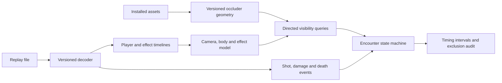

# CS2 reaction and TTK architecture: applicability to VALORANT

Researched 2026-10-04 from vendor explanations, parser documentation, and
commit-pinned public source. The useful transfer is an offline demo-analysis
pipeline with a dedicated visibility model. The inspected implementations do
not provide a way to copy Riot's engine or verify all native VALORANT LOS.
No game-client interaction or modification was performed for this research.

**Leetify documents custom visibility reconstruction.** Its original explanation
tracks player positions and revisits those histories around shots and damage,
checking visibility and crosshair movement. It abandoned radar events because
they could arrive late and miss partial exposure. This is evidence for the
analysis algorithm; it does not disclose the company's complete service stack,
hosting, queue system, or current parser choice. The explanation dates to CS:GO
in 2020. [Vendor explanation](https://leetify.com/blog/enemy-actually-spotted/)

The current CS2 connection is explicit in Leetify's **11 August 2026** update:
its own raycaster previously sampled eight box corners and now uses a more
human-shaped set of checks. The update acknowledges errors around exposed
hands and narrow cover, and changes to resulting aim benchmarks. It does not
describe complete skeletal animation reconstruction or prove pixel-exact
visibility. [2026 hitbox update](https://leetify.com/blog/aim-stat-calculation-hitboxes-improved/)

**Awpy separates parsing from spatial analysis.** Its parser dependency,
demoparser2, exposes demo events and tick properties through a Rust core with
Python/JavaScript interfaces. Available properties include positions, view
angles, crouch state, desired FOV, flash fields and an explicitly approximate
spotted-by mask. These are decoded inputs, not a complete rendered scene.
[Parser documentation](https://github.com/LaihoE/demoparser)

Awpy's VisibilityChecker loads map collision triangles, constructs a BVH once,
and answers segment-occlusion queries. Its older tutorial explicitly warns
that the method is not foolproof. Point-to-point clearance alone omits camera
framing, actual target silhouette and visual effects.
[Current visibility interface](https://awpy.readthedocs.io/en/stable/visibility.html),
[visibility tutorial](https://awpy.readthedocs.io/en/latest/examples/visibility.html)

Its separate awpy-data project builds geometry from game assets, filters and
decimates it, and publishes versioned bundles with checksums and ClientVersion
metadata. Source2Viewer exports the assets; the game engine does not need to
render each analysis query. This asset-build separation is directly useful for
our existing source receipts and cached map geometry.
[Asset pipeline](https://github.com/pnxenopoulos/awpy-data)

**A complete open-source example also exposes the approximations.** Demolens
uses a parser stage, geometry-dependent aim calculations, then aggregate
metrics and JSON output. It labels reconstructed aim results as estimates.
The repository was archived on 5 September 2026 and its author describes it
as an experiment; it is implementation evidence, not an accuracy benchmark.
[Project description](https://github.com/f-gillmann/demolens)

At revision `be3419812ed089be049d90b2fb0da4033d430c6b`, its visibility code
samples body columns, uses eye positions and view angles, and applies a fixed
16:9 frustum. Some gates use nine body points; another uses 30 points. It also
models player blockers as capsules and has fallback smoke and fire volumes.
These simplify runtime anatomy and optics.
[Visibility source](https://github.com/f-gillmann/demolens/blob/be3419812ed089be049d90b2fb0da4033d430c6b/internal/parser/vision.go)

Its smoke decoder reads `CSmokeGrenadeProjectile.m_VoxelFrameData`, reconstructs
a 32-cubed occupancy grid, and traverses that grid for smoke intersections.
The code treats a fade-phase change as the end of blocking. Occupancy decoding
and this binary fade decision are separate claims: the latter does not prove
achieved pixel opacity. We have not established an equivalent final smoke-grid
stream in our VALORANT corpus.
[Smoke source](https://github.com/f-gillmann/demolens/blob/be3419812ed089be049d90b2fb0da4033d430c6b/internal/parser/smokevoxel.go)

Its calibration settings tune FOV, sighting gaps, debounce, flash handling and
sample exclusion. Those policy choices affect the measured population and
onset. They must not be imported as VALORANT engine constants.
[Calibration source](https://github.com/f-gillmann/demolens/blob/be3419812ed089be049d90b2fb0da4033d430c6b/internal/parser/params.go)

**Some tools use a weaker shortcut.** At revision
`635e8c7a152f3026446463cbe8f0ba2e170ec818`, demo-anticheat starts its engagement
clock with `opponent.IsSpottedBy(attacker)`, stops on first damage, allows a
200 ms sighting gap, and derives milliseconds from frames and tick rate.
Despite its description referring to engine LOS, the implementation reads a
replicated spotted mask; it does not invoke the renderer or a native raycast.
This is not a suitable first-visible-frame reference for our project.
[Reaction collector](https://github.com/TimAnthonyAlexander/demo-anticheat/blob/635e8c7a152f3026446463cbe8f0ba2e170ec818/pkg/stats/reaction_collectors.go)

**SCOPE.GG confirms demo analysis but leaves important internals undisclosed.**
Its product page advertises TTK and states that it processes match and demo
data. That does not establish its visibility algorithm, body model, time origin
or latency corrections. We cannot infer those from the displayed numbers.
[Product explanation](https://scope.gg/headshot-stats/)

**The metrics need different time origins.** Leetify documents TTD as first
visibility to first damage; its glossary uses a median and excludes samples
of at least one second. TTD includes aiming, misses and weapon cadence, and
is not pure human reaction time.
[TTD definition](https://leetify.com/blog/leetify-stats-glossary/)

For our project, keep separately named metrics:

| Proposed metric | Time origin and endpoint | Needs validated visual onset? |
| --- | --- | --- |
| Visual response to first shot | First visible contact to first qualifying discharge | Yes |
| Time to damage | First visible contact to first qualifying damage | Yes |
| Firing-to-kill duration | First associated discharge to target death | No; requires validated event association and clocks |
| Visibility-to-kill duration | First visible contact to target death | Yes |

The last two must not silently share a generic TTK label. These are explicit
definitions for our implementation, not claims about every vendor's formula.
Prefire, unseen wallbangs, utility damage, multiple targets, trigger discipline,
revives, and nonresponses require declared inclusion rules.

**Applicability to our current code is substantial but incomplete.** This is
the proposed architecture, synthesized from the inspected designs:

Our `replay-visibility-runtime.js` already has geometry queries, per-point
projection, effect dependencies and contact onset brackets. Its displayed body
model uses three capsule-centerline points and explicitly leaves native camera,
FOV and skeletal pose unverified. The research supports extending this focused
model rather than treating full engine reconstruction as a prerequisite.

| Component | Transfer to this project | Remaining requirement |
| --- | --- | --- |
| Demo decoder and chronological histories | Existing vrfkit exports are the equivalent layer | Semantic completeness and clock validation |
| Reusable static BVH | Existing offline geometry/query design fits | Complete visual occluders and asset/build parity |
| Partial-body ray sampling | Useful experimental extension | Actual silhouette/pose evidence; denser points alone do not verify exposure |
| Frustum and eye reconstruction | Same calculation structure | VALORANT camera, recoil, crouch, ADS, FOV and aspect behavior |
| Effect occlusion | Dedicated dynamic layer fits | Ability-specific opacity, activation, expiry, blindness and reveals |
| Encounter state machine | Transferable | Explicit metric policy, censoring and timing brackets |
| Radar/relevancy shortcut | Unsuitable as ground truth | Keep these observations separate from player visibility |

Riot's documented Fog of War uses optimistic potentially-visible sets and
look-ahead to deliver enemy data before it is needed. Replication availability
therefore cannot be treated as the precise visual-onset clock.
[Riot engineering explanation](https://www.riotgames.com/en/news/demolishing-wallhacks-valorants-fog-war)

Riot also documents differences between replay POV and an original gameplay
recording, including timing and animation. Even a native replay frame must
be described as replay-rendered evidence rather than a guarantee of the
original player's display timing.
[Replay limitations](https://playvalorant.com/en-us/news/dev/replays-everything-you-need-to-know/)

**Next useful offline work:** improve body exposure sampling against the
extracted agent meshes with explicit pose uncertainty; refine event-centered
visibility windows while retaining missed/nonresponse encounters; measure
sensitivity to camera, pose and effect assumptions; report coverage and timing
bounds alongside estimates. A single exposed target point must pass the view,
wall and effect checks together. A blocked center ray cannot prove the entire
body hidden. Unknown inputs must continue to invalidate claimed native LOS.

This research establishes an applicable architecture, not new LOS validation.
All native verification flags remain unchanged and uncertain visibility remains
unknown. Source text was inspected, not executed. Nine commit-pinned files and
their SHA-256 receipts are retained under
`.local/replay-transcripts/cs2-architecture-research-2026-10-04/`.
